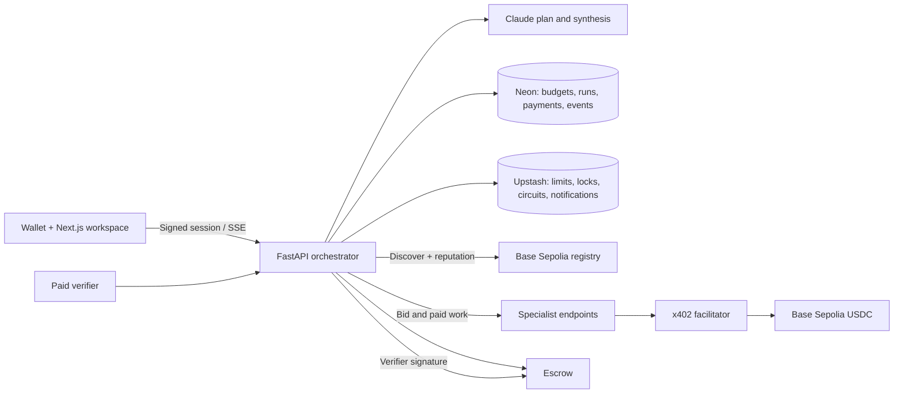
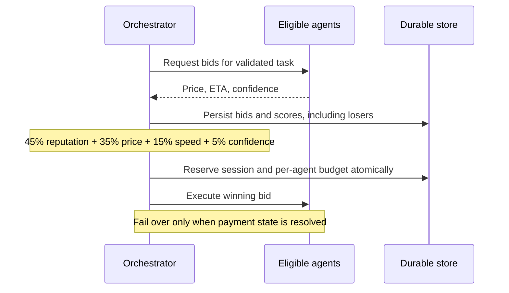

# Agent Bazaar


**One goal. An economy of specialists working toward it.**

Agent Bazaar decomposes a goal into a dependency graph, auctions each task to registered agents, pays in USDC through x402, verifies their work, and records payment-weighted reputation on Base Sepolia. Larger jobs use signed-release escrow.

Most agent tools hide execution and costs. Bazaar exposes the bids, decisions, spending, outputs, and transaction receipts in one workspace.

## Preview the frontend

Requires Node.js 22+. From the repository root:

```powershell
npm --prefix web ci
npm --prefix web run dev
```

Open **http://localhost:3000**. If dependencies are already installed, only the second command is needed. The interface works without backend credentials and clearly reports an unavailable network. There is no runtime demo mode or fabricated activity.


<details><summary>Mobile screenshot</summary>


</details>

## What is implemented

| Feature | Implementation / verification boundary |
| --- | --- |
| Mission workspace | Responsive composer, command palette, optional browser speech input, activity stream, spending ring, and event replay |
| Swarm | React Flow nodes, auction/winner/failover states, animated payment routes; populated from the real registry |
| Agent details | Current on-chain reputation, this run's bid history, execution trace, and receipt links |
| Discovery and history | Agent directory, searchable wallet-owned runs across sessions, shared run URLs, registration wizard |
| Wallet authorization | Injected EVM wallet, signed one-hour budget authorization, server-enforced sponsor spending limits |
| Specialists | Six capabilities across eight endpoint configurations; actual Claude, chain RPC, and image-provider calls |
| Orchestration | Structured Claude tool-use planning, validated DAG, concurrent independent tasks, auctions, paid verification, synthesis |
| Payments | x402 v2 exact USDC, durable signed-payload replay, on-chain Transfer receipt checks, escrow for large obligations |
| Reliability | Atomic Postgres budget reservations, durable events/checkpoints, Redis circuit breakers, bounded retries and execution |
| Contracts | Registry, value-weighted decaying reputation, EIP-712 escrow release, deadline refunds; unit/fuzz/invariant tests |
| Deployment tooling | Two Vercel project configurations, contract broadcast/verification/export, eight-agent registration, live-goal test |

**Deployment, real agent registration, and live paid-goal validation have not been executed.** They require your credentials and funded wallets. The repository contains their implementations and commands, not invented completion evidence.

## Architecture





```mermaid
sequenceDiagram
  participant B as Buyer
  participant A as Agent
  participant F as Facilitator
  participant C as Base Sepolia
  B->>A: POST task
  A-->>B: 402 Payment-Required
  B->>B: Validate recipient, chain, asset, amount; persist signed authorization
  B->>A: Same task + Payment-Signature
  A->>F: Verify payment
  A->>A: Execute and persist result
  A->>F: Settle signed payment
  F->>C: Transfer USDC
  A-->>B: Result + Payment-Response
  B->>C: Check successful receipt and exact Transfer
  Note over B,A: Ambiguous settlement preserves budget; no fresh automatic charge
```

## Stack choices

| Stack | Purpose |
| --- | --- |
| Next.js 15, React, TypeScript | Typed App Router UI and Vercel frontend deployment |
| Tailwind, shadcn/Radix, Geist | Consistent styling, accessible dialogs and controls |
| Motion, React Flow | Reduced-motion-aware transitions and event-driven agent graph |
| wagmi, viem, Zustand, React Query | Wallet transactions, session state, server-data fetching |
| Python 3.12, FastAPI, Pydantic | Typed API, validation, ASGI streaming |
| Anthropic SDK, tenacity | Tool-use planning, prompt caching, controlled retry behavior |
| x402 SDK, web3.py | Paid HTTP requests, USDC receipts, durable chain transactions |
| Neon Postgres, Upstash Redis | Authoritative durable accounting plus limits and coordination |
| Foundry, OpenZeppelin | Contract implementation, fuzzing, invariants, deployment scripts |

## Setup and deploy

Use [DEPLOY-FRONTEND.md](DEPLOY-FRONTEND.md) to preview and publish the redesigned frontend. Backend deployment and live funded validation remain separate operator steps. To install all local dependencies after installing Node 22, Python/uv, Git, and Foundry:

```powershell
Copy-Item .env.example .env
# Fill .env locally, then:
powershell -ExecutionPolicy Bypass -File scripts/setup.ps1
```

Private settings belong only in the API project or local `.env`. `scripts/sync_public_env.py` copies only the three public frontend settings into `web/.env.local`. Never place private keys in a `NEXT_PUBLIC_*` variable.

## Checks and evidence

Run the frontend in another terminal, then:

```powershell
api/.venv/Scripts/python.exe scripts/check_phase.py
```

The aggregate records actual Forge, pytest, Next build, and Playwright results in [docs/phase-checks.json](docs/phase-checks.json). Additional evidence:

- [Desktop/mobile accessibility results](docs/accessibility.json)
- [Measured Lighthouse report](docs/lighthouse.json) — local frontend only, not a deployed/live-agent benchmark
- [Package source verification](docs/package-verification.json) and [tooling sources](docs/tooling-sources.md)
- [Frontend redesign notes](docs/redesign.md)
- [Current frontend review, assembly artwork, and scroll verification](docs/frontend-review.md)

The live goal test deliberately skips when a real funded deployment and session are absent. Test doubles exist only in isolated API tests.

## MCP development tools

`scripts/configure_mcp.py` backs up the user configuration before adding Context7, Playwright, shadcn, and GitHub MCP entries. GitHub needs a local `GITHUB_PAT`; it is never committed. Existing servers are preserved.

The repository's `scripts/mcp-client.mjs` connects using the official MCP SDK. Example: `node scripts/mcp-client.mjs playwright list`. Context7 research and shadcn component selection informed the implementation; Playwright MCP produced the screenshots.

## Repository

```text
web/          Next.js UI, wallet integration, CSP middleware
api/          FastAPI, specialist endpoints, payment orchestration, schema, tests
contracts/    Foundry registry, escrow, tests, deployment script
shared/       Exported ABIs; addresses appear only after successful broadcast
scripts/      Setup, checks, deployment, seeding, screenshots, audits, refunds
tests/e2e/    Desktop/mobile browser smoke tests
tests/live/   Real funded goal test (explicit prerequisites)
docs/         Evidence, screenshots, implementation notes and security review
```

## Security model and limits

This is a hackathon implementation on **Base Sepolia**, not audited production custody software. A server wallet sponsors agent payments. The user signs a bounded one-hour authorization; this is a server-enforced bearer session, not an on-chain smart-account session key. Keep the sponsor invite private. Session caps do not impose a global lifetime cap across independently authorized sessions.

Only exact HTTPS allowlisted hosts are eligible. DNS checks reject private targets and redirects are disabled; a hostile DNS-rebinding host still warrants network-level egress controls. Agent outputs are treated as untrusted text and never executed. Pattern filtering is supplemental, not a complete prompt-injection defense. PostgreSQL is authoritative for budgets, reservations, signed payments and run events; Redis pub/sub is a notification hint.

Ambiguous payment/transaction outcomes require reconciliation before releasing held budget. An expired escrow can be refunded with `scripts/refund_escrow.py PAYMENT_ID`. A run pauses before the function deadline and can resume within its original spending authorization. Shared URLs expose the goal, results and event trace to anyone holding the link; creating a new share token invalidates the old link.

The planner currently produces one validated DAG, not an unrestricted autonomous reasoning loop. Reputation history is not indexed; the drawer displays the current score. Eight seeded endpoint configurations share this deployment and payee; they are not eight independently operated businesses. Faucet helpers open the real providers and do not bypass their login/rate limits. Only injected wallets are integrated. Live service behavior, concurrent database accounting, and deployed streaming still need the documented integration pass.

## Roadmap

- Independent agent operators and verifier separation.
- Historical reputation indexing and richer comparison charts.
- Reconciliation dashboard and global sponsor spending policy.
- Durable external job scheduling beyond request-duration windows.
- WalletConnect, smart-account session keys, and audited production contracts.

MIT licensed. See [LICENSE](LICENSE).
